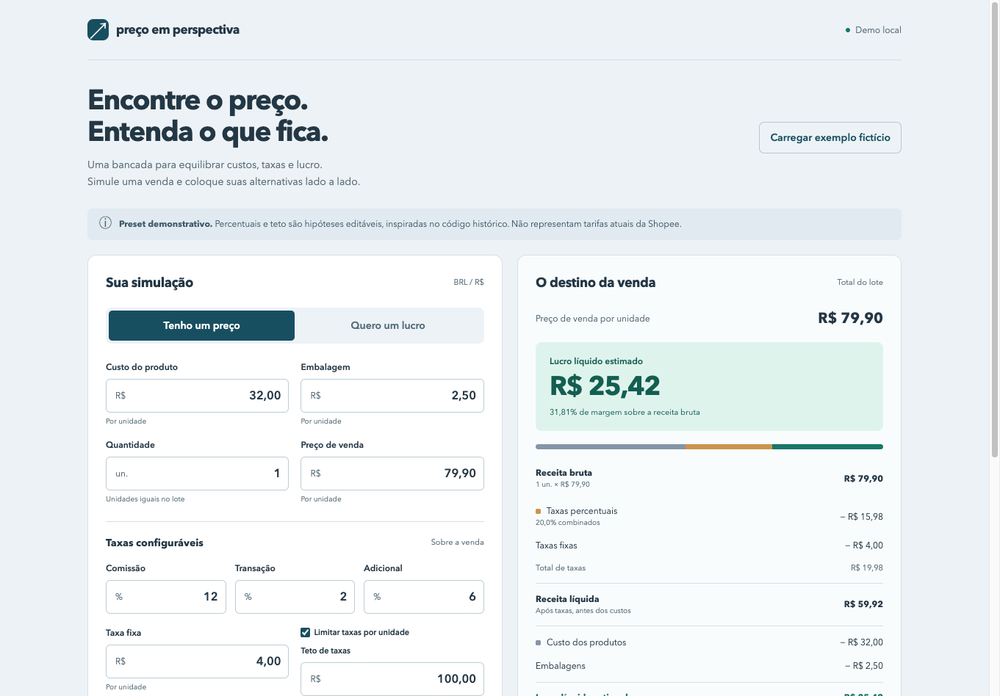

# Pricing in Perspective

A React + TypeScript pricing simulator for exploring selling prices, costs, fees and profit in Brazilian reais. Start with a unit price or a desired batch profit, edit the assumptions and compare up to four scenarios. The interface remains in Brazilian Portuguese.

**The preset is an illustrative scenario, not verified current Shopee rates.** This independent portfolio project has no marketplace connection and provides no official quote, tax calculation or fiscal advice.

## Run locally

Requires Node.js 20.19+ or 22.12+ and npm. From the repository root:

```bash
npm ci
npm run dev
```

Open the loopback URL printed by Vite, usually http://127.0.0.1:5173/. Stop your own server with Ctrl+C. If another demo already owns that port, preserve it and use `npm run dev -- --port 5174 --strictPort` with an available port.

```bash
npm test
npm run typecheck
npm run build
npm run preview
```

`npm test` compiles the pure calculation engine into ignored `.test-build/` and runs Node's built-in test runner. `build` typechecks and produces `dist/`; `preview` serves that production build locally, normally on port 4173. Neither command deploys the app. Agents in this workspace prefix shell commands with `rtk` (use `rtk proxy` when raw output is needed).

## Try the calculator

1. Load the fictional example: unit cost R$32.00, packaging R$2.50, price R$79.90, one unit, combined fees 20%, fixed fee R$4.00 and fee cap R$100.00. Fees are R$19.98, net revenue R$59.92 and profit R$25.42.
2. Save a scenario using **Salvar cenário**. Change the price to R$69.90 and save another: profit becomes R$17.42, while the first snapshot stays unchanged.
3. Choose **Quero um lucro** and set a R$25.00 batch profit target. The minimum unit price is R$79.37 under these assumptions.
4. Change quantity, costs, rates or the optional cap. Compare batch totals carefully; only the price column is per unit.
5. Remove a scenario to free capacity. Loading the example preserves saved scenarios; reloading the page clears them.

Full demo steps and the delivery history are in [the portfolio plan](docs/PORTFOLIO-PLAN.md).

## Actual interface screenshots



Actual production-preview capture at 1361 × 948 CSS pixels. The example yields R$25.42 profit after modeled fees and costs.

[Narrow-screen inputs](docs/screenshots/mobile.png) and [narrow-screen results](docs/screenshots/mobile-results.png) show the same app at 390 × 844 CSS pixels. These are real browser viewport captures, not generated illustrations or physical-device test evidence. See [capture details](docs/screenshots/README.md).

## Calculation model

```text
gross revenue = unit price × quantity
percentage fee per unit = round(unit price in cents × combined basis points / 10,000)
fee per unit = percentage fee + fixed fee, limited by the optional cap
net revenue = gross revenue − total fees
estimated profit = net revenue − product costs − packaging costs
margin = profit / gross revenue × 100
```

The engine uses integer cents and basis points (100 basis points = 1%). It rounds the combined percentage fee once per unit, then multiplies by quantity. The breakdown shows the cap reduction separately so every total reconciles. **Net revenue is after fees but before costs; it is not profit.** Inverse pricing uses a binary search for the lowest cent-denominated unit price reaching the total batch profit target; rounding can exceed the target.

Inputs accept decimal commas or points, up to two decimal places, without thousands separators. Costs, fees and target profit can be zero; unit price must be at least R$0.01. Monetary fields are limited to R$1 million, quantity to integers from 1 to 10,000, and combined percentage fees to less than 100%. Invalid inputs show an error and disable saving. Negative profit is shown as an estimated loss.

## Preserved history

[legacy.html](legacy.html) preserves the original calculator with a visible archive warning. Its `script.js`, `style.css` and `test.html` are retained. Visit `/legacy.html` on the development server; the legacy page needs a CDN for icons. The production build includes the React app only.

Intentional changes from the original:

- Quantity multiplies revenue, percentage fees and costs as well as fixed fees and caps.
- Profit subtracts product and packaging costs; the legacy margin used only revenue after fees.
- Inverse pricing targets profit after costs rather than only revenue after fees.
- The historical below-R$8 half-price item fee and CPF R$5 option remain in the archive; the new fixed fee is always the editable parameter.
- Historical optional campaign fees can be explored through the editable additional percentage, without implying current eligibility.
- The new breakdown reconciles the total fee cap through a separate reduction line.

The historical `test.html` harness depends on missing main-form elements and is not a reliable standalone test suite. Use `npm test` for the new engine.

## Project structure

```text
src/calculator.ts          Pure engine, parsing, validation and BRL formatting
src/App.tsx                React interface and scenario snapshots
src/styles.css             Responsive layout and styles
src/main.tsx               React entry point
index.html                 Vite entry point
package.json / lockfile    Local commands and resolved dependencies
tsconfig.json              Strict TypeScript configuration
tests/calculator.test.mjs  Calculation behavior tests
docs/PORTFOLIO-PLAN.md     Product decisions, demo and validation history
AGENTS.md                  Canonical portfolio workflow instructions
legacy.html                Archived interface with warning
script.js / style.css      Original code preserved
test.html                  Historical harness
```

## Validation and limits

The automated suite covers rounding, net revenue versus profit, quantity, caps, zero values, loss, minimal inverse prices, parsing and input limits. Production typecheck/build and a local Orca browser flow were also exercised. Browser inputs updated correctly; button actions were verified through DOM activation because Orca's typed click/key commands did not activate them in the tested tab. This does not establish physical pointer/keyboard usability, physical mobile-device behavior or screen-reader compatibility. Desktop and narrow-screen viewport captures were visually reviewed; pointer/keyboard and assistive-technology reviews remain open.

This app omits seller-paid shipping, taxes, advertising, returns and operating expenses. Real platforms may use different bases and rounding rules. It has no backend, persistence, export or current-rate lookup. Actual desktop and narrow-screen screenshots are included. No public deployment or generated artwork is included; the coordinator's illustrative README cover and an optional demo recording remain follow-up work.

## Contributing

Follow [AGENTS.md](AGENTS.md), keep assumptions editable and documentation consistent with the engine, and run the meaningful tests, typecheck and build before delivery. Preserve legacy assets and existing demos.

## License

The repository has no LICENSE file. Do not assume an MIT license or permission to redistribute.
